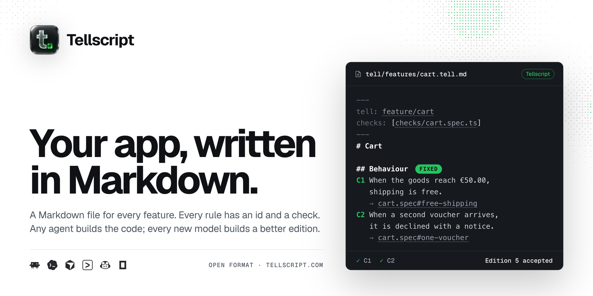

  <a href="https://tellscript.com">
    <picture>
      <source media="(prefers-color-scheme: dark)" srcset="assets/banner-dark.jpg">
      
    </picture>
  </a>

**Tellscript is an open Markdown format for the part of your software that should outlive its code.** A folder
`tell/` next to your code records what the app must do, how it must look and why, and every rule points to the check
that proves it. Claude Code, Codex, Cursor or any other agent builds the code from it; every new model builds the
next, better edition.

### Start here

- **Try it:** the [quickstart](https://tellscript.com/docs/quickstart), one prompt, one feature, one afternoon
- **Teach your agent:** `npx skills add tellscript-dev/tellscript`
- **Read the format:** the [spec, draft 0.1](https://github.com/tellscript-dev/tellscript/blob/main/spec/draft.md) and the [docs](https://tellscript.com/docs)
- **See a real one:** [Castwell](https://github.com/tellscript-dev/tellscript/tree/main/examples/castwell), a small shop in four files

### Get involved

Tellscript is a draft, and the best proposals come from people who tried it on a real app.
Open a [spec change](https://github.com/tellscript-dev/tellscript/issues/new/choose), share what you built in
[Discussions](https://github.com/tellscript-dev/tellscript/discussions), and read
[how we work](https://github.com/tellscript-dev/.github/blob/main/CONTRIBUTING.md).

Maintained by [Riverlabs](https://riverlabs.de) in Berlin · Spec and docs CC BY 4.0 · Tools Apache 2.0
